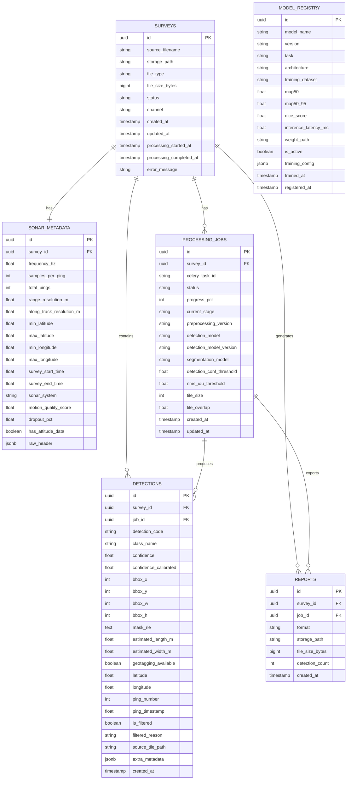

# DB_SCHEMA.md
## MarineDebris-Sonar-AI — Database Schema

**Database:** PostgreSQL 16  
**ORM:** SQLAlchemy 2.0 (async)  
**Migrations:** Alembic  
**Version:** 1.0 — August 2026  

---

## 1. Entity Relationship Diagram (Mermaid)



---

## 2. Table Schemas

### 2.1 `surveys`

Represents one uploaded sonar file/survey session.

```sql
CREATE TABLE surveys (
    id                      UUID PRIMARY KEY DEFAULT gen_random_uuid(),
    source_filename         VARCHAR(512) NOT NULL,
    storage_path            VARCHAR(1024) NOT NULL,
    file_type               VARCHAR(16) NOT NULL CHECK (file_type IN ('xtf', 'jsf', 'png', 'tiff')),
    -- 'xtf' and 'png' are the initial supported formats (parser implemented at MVP, see PRD.md §4.1).
    -- 'jsf' and 'tiff' are accepted values reserved for forward compatibility; their parsers are V1/deferred.
    -- Upload extension '.tif' and '.tiff' both map to file_type = 'tiff'.
    file_size_bytes         BIGINT NOT NULL,
    status                  VARCHAR(32) NOT NULL DEFAULT 'uploaded'
                            CHECK (status IN ('uploaded', 'queued', 'preprocessing',
                                              'inferring', 'postprocessing', 'georeferencing',
                                              'reporting', 'complete', 'failed')),
    channel                 VARCHAR(16) CHECK (channel IN ('port', 'starboard', 'both', 'unknown')),
    created_at              TIMESTAMPTZ NOT NULL DEFAULT now(),
    updated_at              TIMESTAMPTZ NOT NULL DEFAULT now(),
    processing_started_at   TIMESTAMPTZ,
    processing_completed_at TIMESTAMPTZ,
    error_message           TEXT
);

CREATE INDEX idx_surveys_status ON surveys (status);
CREATE INDEX idx_surveys_created_at ON surveys (created_at DESC);
```

---

### 2.2 `sonar_metadata`

Navigation and sonar configuration metadata extracted from XTF/JSF header or supplied nav CSV.

```sql
CREATE TABLE sonar_metadata (
    id                          UUID PRIMARY KEY DEFAULT gen_random_uuid(),
    survey_id                   UUID NOT NULL REFERENCES surveys(id) ON DELETE CASCADE,
    frequency_hz                FLOAT,
    samples_per_ping            INTEGER,
    total_pings                 INTEGER,
    range_resolution_m          FLOAT,
    along_track_resolution_m    FLOAT,
    min_latitude                FLOAT,
    max_latitude                FLOAT,
    min_longitude               FLOAT,
    max_longitude               FLOAT,
    survey_start_time           FLOAT,       -- Unix timestamp
    survey_end_time             FLOAT,
    sonar_system                VARCHAR(128),
    -- Sonar Quality / Motion Robustness Layer output (PRD.md §4, §7; PS26057 heave/pitch/roll/dropout requirement)
    motion_quality_score        FLOAT,       -- 0-1 aggregate quality score for the survey; NULL if not computed
    dropout_pct                 FLOAT,       -- % of pings flagged as data dropout
    has_attitude_data           BOOLEAN NOT NULL DEFAULT FALSE,  -- TRUE only if source file provided pitch/roll per ping
    raw_header                  JSONB,       -- Full parsed header for reference
    CONSTRAINT uq_sonar_metadata_survey UNIQUE (survey_id)
);
```

---

### 2.3 `processing_jobs`

Tracks each pipeline execution for a survey. A survey can be reprocessed with different model settings, generating a new job.

```sql
CREATE TABLE processing_jobs (
    id                          UUID PRIMARY KEY DEFAULT gen_random_uuid(),
    survey_id                   UUID NOT NULL REFERENCES surveys(id) ON DELETE CASCADE,
    celery_task_id              VARCHAR(256),
    status                      VARCHAR(32) NOT NULL DEFAULT 'pending'
                                CHECK (status IN ('pending', 'running', 'complete', 'failed', 'cancelled')),
    progress_pct                SMALLINT DEFAULT 0 CHECK (progress_pct BETWEEN 0 AND 100),
    current_stage               VARCHAR(128),
    preprocessing_version       VARCHAR(64),
    detection_model             VARCHAR(256),
    detection_model_version     VARCHAR(64),
    segmentation_model          VARCHAR(256),
    detection_conf_threshold    FLOAT NOT NULL DEFAULT 0.35,
    nms_iou_threshold           FLOAT NOT NULL DEFAULT 0.45,
    tile_size                   INTEGER NOT NULL DEFAULT 640,
    tile_overlap                FLOAT NOT NULL DEFAULT 0.2,
    created_at                  TIMESTAMPTZ NOT NULL DEFAULT now(),
    updated_at                  TIMESTAMPTZ NOT NULL DEFAULT now()
);

CREATE INDEX idx_jobs_survey_id ON processing_jobs (survey_id);
CREATE INDEX idx_jobs_status ON processing_jobs (status);
CREATE INDEX idx_jobs_celery_task ON processing_jobs (celery_task_id);
```

---

### 2.4 `detections`

Core table. One row per detected object after NMS and confidence filtering.

```sql
CREATE TABLE detections (
    id                      UUID PRIMARY KEY DEFAULT gen_random_uuid(),
    survey_id               UUID NOT NULL REFERENCES surveys(id) ON DELETE CASCADE,
    job_id                  UUID NOT NULL REFERENCES processing_jobs(id) ON DELETE CASCADE,
    detection_code          VARCHAR(32) NOT NULL,    -- Human-readable e.g. "D000123"
    class_name              VARCHAR(64) NOT NULL
                            -- Canonical taxonomy — see PRD.md §8. 'natural_feature' is only ever
                            -- used on rows where is_filtered = TRUE (rejected candidate, kept for audit).
                            CHECK (class_name IN (
                                'derelict_fishing_gear',
                                'general_marine_debris',
                                'shipwreck',
                                'pipe_or_cylinder',
                                'other_man_made_target',
                                'natural_feature'
                            )),
    confidence              FLOAT NOT NULL,          -- Model Confidence: raw detector score 0-1, NOT a calibrated probability (see PRD.md §1.1)
    confidence_calibrated   FLOAT,                   -- Final Anomaly Confidence: confidence after temperature/Platt scaling + sonar-aware verification adjustment (see PRD.md §1.1)
    -- Bounding box in full survey image pixel space
    bbox_x                  INTEGER NOT NULL,
    bbox_y                  INTEGER NOT NULL,
    bbox_w                  INTEGER NOT NULL,
    bbox_h                  INTEGER NOT NULL,
    -- Segmentation mask (stored as RLE string; null if detection-only run)
    mask_rle                TEXT,
    -- Estimated real-world dimensions
    estimated_length_m      FLOAT,
    estimated_width_m       FLOAT,
    -- Geolocation
    geotagging_available     BOOLEAN NOT NULL DEFAULT FALSE,  -- FALSE when source ping lacked navigation metadata; never fabricate lat/lon in that case
    latitude                FLOAT,
    longitude               FLOAT,
    -- Source ping reference
    ping_number             INTEGER,
    ping_timestamp          FLOAT,
    -- Filtering
    is_filtered             BOOLEAN NOT NULL DEFAULT FALSE,
    filtered_reason         VARCHAR(256),            -- e.g. "acoustic_shadow_mismatch"
    -- Debug
    source_tile_path        VARCHAR(1024),
    extra_metadata          JSONB,
    created_at              TIMESTAMPTZ NOT NULL DEFAULT now()
);

CREATE INDEX idx_detections_survey ON detections (survey_id);
CREATE INDEX idx_detections_job ON detections (job_id);
CREATE INDEX idx_detections_class ON detections (class_name);
CREATE INDEX idx_detections_confidence ON detections (confidence DESC);
CREATE INDEX idx_detections_latlon ON detections (latitude, longitude)
    WHERE latitude IS NOT NULL AND longitude IS NOT NULL;
CREATE INDEX idx_detections_filtered ON detections (is_filtered);
```

---

### 2.5 `reports`

Exported report files (JSON, CSV, GeoJSON) linked to a job.

```sql
CREATE TABLE reports (
    id              UUID PRIMARY KEY DEFAULT gen_random_uuid(),
    survey_id       UUID NOT NULL REFERENCES surveys(id) ON DELETE CASCADE,
    job_id          UUID NOT NULL REFERENCES processing_jobs(id) ON DELETE CASCADE,
    format          VARCHAR(16) NOT NULL CHECK (format IN ('json', 'csv', 'geojson')),
    storage_path    VARCHAR(1024) NOT NULL,
    file_size_bytes BIGINT,
    detection_count INTEGER,
    created_at      TIMESTAMPTZ NOT NULL DEFAULT now()
);

CREATE INDEX idx_reports_survey ON reports (survey_id);
CREATE INDEX idx_reports_job ON reports (job_id);
```

---

### 2.6 `model_registry`

Tracks trained model versions. The active model is determined by `is_active = TRUE` per task.

```sql
CREATE TABLE model_registry (
    id                  UUID PRIMARY KEY DEFAULT gen_random_uuid(),
    model_name          VARCHAR(256) NOT NULL,
    version             VARCHAR(64) NOT NULL,
    task                VARCHAR(32) NOT NULL CHECK (task IN ('detection', 'segmentation', 'edge_detection')),
    architecture        VARCHAR(128),        -- e.g. "yolov8m", "unet_resnet34"
    training_dataset    TEXT,               -- Comma-separated dataset names
    map50               FLOAT,
    map50_95            FLOAT,
    dice_score          FLOAT,              -- For segmentation models
    inference_latency_ms FLOAT,
    weight_path         VARCHAR(1024),
    is_active           BOOLEAN NOT NULL DEFAULT FALSE,
    training_config     JSONB,
    trained_at          TIMESTAMPTZ,
    registered_at       TIMESTAMPTZ NOT NULL DEFAULT now(),
    CONSTRAINT uq_model_version UNIQUE (model_name, version, task)
);

CREATE INDEX idx_model_registry_task_active ON model_registry (task, is_active);
```

---

## 3. Indexing Strategy

| Index | Table | Column(s) | Reason |
|---|---|---|---|
| `idx_surveys_status` | surveys | status | Filter surveys by processing state |
| `idx_surveys_created_at` | surveys | created_at DESC | Dashboard list ordering |
| `idx_jobs_survey_id` | processing_jobs | survey_id | Join surveys → jobs |
| `idx_jobs_celery_task` | processing_jobs | celery_task_id | Celery result lookup |
| `idx_detections_survey` | detections | survey_id | Fetch all detections for a survey |
| `idx_detections_class` | detections | class_name | Filter by detection class |
| `idx_detections_confidence` | detections | confidence DESC | Rank by confidence |
| `idx_detections_latlon` | detections | latitude, longitude (partial) | Map bounding box queries |
| `idx_detections_filtered` | detections | is_filtered | Exclude/include filtered detections |
| `idx_model_registry_task_active` | model_registry | task, is_active | Fetch active model per task |

---

## 4. Seed Data Templates

**All values in this section are illustrative/mock demo-mode fixtures, not validated benchmark results.** `sonar_yolov8m_ghostpot_v1` is a placeholder model name/version until an actual model has been trained and registered; `map50`/`map50_95`/`inference_latency_ms` values below are example numbers only.

### 4.1 Sample Survey (for demo mode)

```sql
INSERT INTO surveys (id, source_filename, storage_path, file_type, file_size_bytes, status, channel)
VALUES (
    '00000000-0000-0000-0000-000000000001',
    'demo_delaware_survey_01.xtf',
    '/data/storage/surveys/demo/demo_delaware_survey_01.xtf',
    'xtf',
    52428800,
    'complete',
    'starboard'
);
```

### 4.2 Sample Detection (JSON representation, illustrative)

```json
{
  "detection_id": "D000001",
  "survey_id": "00000000-0000-0000-0000-000000000001",
  "job_id": "00000000-0000-0000-0000-000000000002",
  "class_name": "derelict_fishing_gear",
  "confidence": 0.87,
  "confidence_calibrated": 0.83,
  "bbox": {"x": 314, "y": 220, "w": 68, "h": 44},
  "estimated_length_m": 3.2,
  "estimated_width_m": 1.1,
  "geotagging_available": true,
  "latitude": 38.812345,
  "longitude": -75.134567,
  "ping_number": 1042,
  "is_filtered": false,
  "filtered_reason": null,
  "processing": {
    "preprocessing_version": "v1.0",
    "detection_model": "sonar_yolov8m_ghostpot_v1",
    "detection_model_version": "1.0.0"
  }
}
```

### 4.3 Sample Model Registry Seed (illustrative — not a real training result)

```sql
INSERT INTO model_registry (
    model_name, version, task, architecture, training_dataset,
    map50, map50_95, inference_latency_ms, weight_path, is_active, trained_at
)
VALUES (
    'sonar_yolov8m_ghostpot_v1',
    '1.0.0',
    'detection',
    'yolov8m',
    'ghost_pot_sss,subpipe',
    0.724,
    0.481,
    42.3,
    '/models/detection/sonar_yolov8m_ghostpot_v1.pt',
    TRUE,
    '2026-08-01 00:00:00+00'
);
```

---

## 5. Migration Notes

- Alembic migration files live in `backend/database/migrations/versions/`.
- Always run `alembic upgrade head` before starting the backend.
- Never modify `autogenerate` migrations without reviewing the diff — PostGIS-style spatial columns require manual edits.
- The `detections.mask_rle` column is TEXT (not BYTEA) to keep RLE strings human-readable and debuggable.

---

*End of DB_SCHEMA.md*
