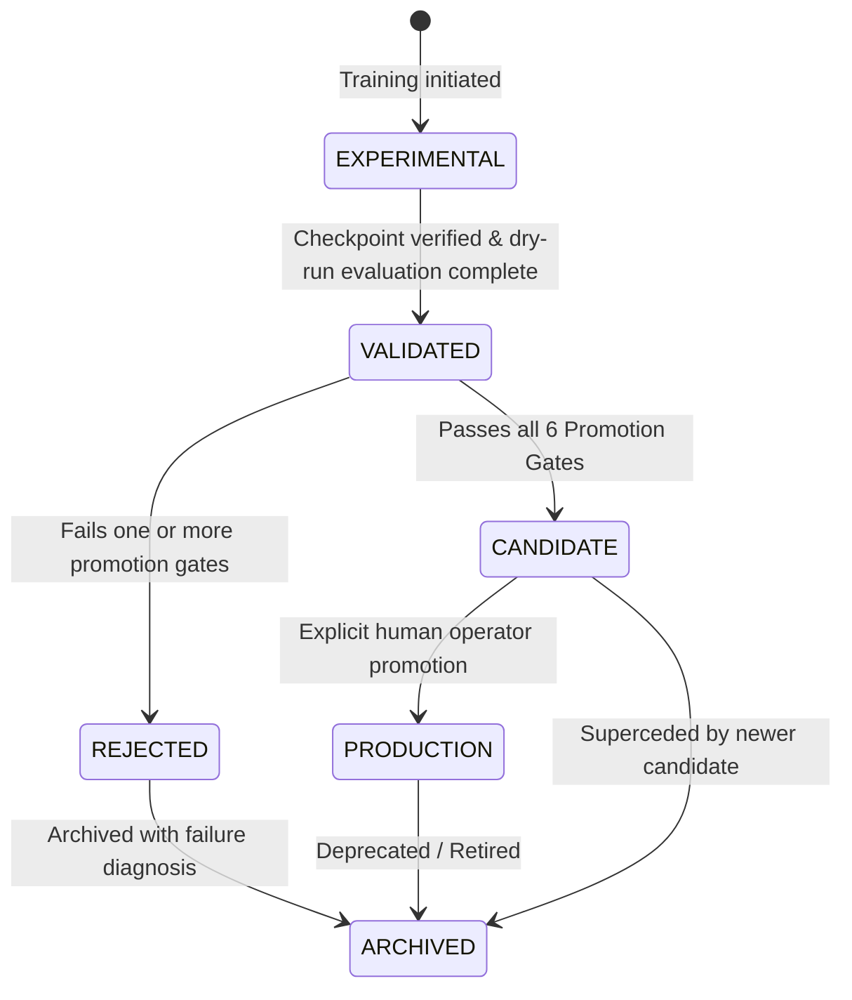

# Model Registry & Production Promotion Policy

This document defines the formal promotion criteria, gatekeeper architecture, cryptographic safeguards, and lifecycle state transitions governing sonar object-detection models in `MarineDebris-Sonar-AI`.

---

## 1. Non-Negotiable Invariants

1. **Production Model Immutability**:
   The golden production checkpoint (`models/detection/sonar_yolov8_fls_trained.pt`) is frozen with SHA-256 digest:
   $$\texttt{e1215c7e7f6e4f3722398bf93d975eb5013c49f78355d0d5f54ce982d495b3d7}$$
   No automated script, pipeline stage, or training harness is permitted to overwrite this file.
2. **Quarantined Training Directory**:
   All candidate checkpoints must be saved exclusively to `models/detection/experiments/{experiment_id}/`.
3. **No Automatic Promotion**:
   Even if a candidate model passes all mathematical and operational gates, promotion to active production requires human-in-the-loop administrative review and signed authorization.
4. **Real-Only Evaluation Protocol**:
   Promotion eligibility must be demonstrated exclusively on genuine, real-world held-out test data. Synthetic images are prohibited from all promotion gates.

---

## 2. Model Lifecycle State Machine

| Lifecycle Status | Operational Meaning | Access Control |
| :--- | :--- | :--- |
| **`EXPERIMENTAL`** | Active training run or unverified checkpoint | Read-only to ML research team |
| **`VALIDATED`** | Successfully evaluated on benchmark splits | Staged in experiment registry |
| **`CANDIDATE`** | Passed all 6 Promotion Gates; awaiting sign-off | Available for operational side-by-side trials |
| **`PRODUCTION`** | Active production detector deployed to AUV/vessel | Serves real-time live sonar inference |
| **`REJECTED`** | Failed one or more regression or safety gates | Retained in audit log with failure rationale |
| **`ARCHIVED`** | Historical or superceded model | Preserved for scientific reproducibility |

---

## 3. The Six Mandatory Promotion Gates

Every candidate model must be evaluated through `PromotionGate` against the frozen production baseline:

| Gate | Target Metric | Baseline Value | Required Threshold | Operational Justification |
| :--- | :--- | :--- | :--- | :--- |
| **Gate 1** | **V2 Legacy mAP@50** | 89.21% | $\ge 88.21\%$ (max $-1.0\%$ abs regression) | Prevents catastrophic forgetting of peer-reviewed legacy debris targets. |
| **Gate 2** | **V2 Legacy Recall** | 90.15% | $\ge 88.15\%$ (max $-2.0\%$ abs regression) | Prevents loss of detection sensitivity on ghost nets and crab pots. |
| **Gate 3** | **V3 Generalization mAP@50** | 91.92% | $\ge 89.92\%$ | Asserts genuine cross-sequence generalization on expanded real sonar data. |
| **Gate 4** | **Hard-Negative FAR** | 21.43% | $\le 21.43\%$ (18/84 frames) | Rejects models that increase false alarms on reverberant quarry seabed. |
| **Gate 5** | **Hard-Negative Total FP Boxes** | 18 boxes | $\le 18$ boxes | Bounds the maximum number of spurious detections across negative surveys. |
| **Gate 6** | **CPU P95 Latency** | 85.57 ms | $\le 125.0\text{ ms}$ ($\ge 8.0\text{ FPS}$) | Ensures embedded CPU edge compatibility on AUVs without GPU acceleration. |

### Optional Multi-Seed Stability Requirement (For High-Impact Releases)
When multi-seed verification is enabled, candidate models trained across 3 independent seeds ($\text{seed} \in \{42, 123, 2026\}$) must exhibit:
$$\sigma(\text{mAP50}) \le 1.50\% \quad \text{across all seeds}$$
This guarantees that performance gains reflect systematic algorithm improvements rather than stochastic initialization luck.
