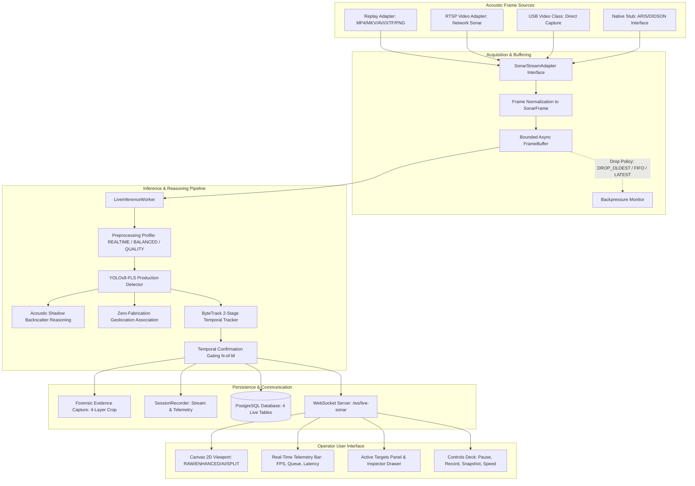

# MarineDebris-Sonar-AI: Live Sonar Subsystem Architecture

## 1. Executive Summary

The Live Sonar Subsystem provides a real-time, low-latency acoustic frame acquisition, enhancement, AI object detection, temporal tracking, and multi-layer forensic evidence logging subsystem integrated into the `MarineDebris-Sonar-AI` platform.

The architecture strictly decouples:
1. **Acoustic Acquisition & Normalization** (`SonarStreamAdapter`, `SonarFrame`)
2. **Backpressure-Managed Buffering** (`FrameBuffer` with bounded memory and drop policies)
3. **AI Pipeline & Temporal Reasoning** (`ModelLoader`, `detect_tiles`, `ByteTrackSonarTracker`, `TemporalConfirmationFilter`)
4. **Forensic Evidence Capture & Recording** (`capture_evidence`, `SessionRecorder`, Alembic migration `0003_live_sonar_subsystem.py`)
5. **Real-time Web Delivery & UX** (FastAPI WebSocket preview stream, REST query APIs, React HTML5 Canvas 2D decoupled rendering viewport)

---

## 2. End-to-End Pipeline Architecture

---

## 3. Data Flow & Core Invariants

### 3.1 Raw Frame Immutability
Incoming sonar frames are encapsulated in `SonarFrame` as read-only NumPy arrays. Preprocessing creates a separate processed image without mutating the original raw frame. The four distinct representations maintained per frame are:
1. `raw_frame`: Original sensor matrix
2. `processed_frame`: Filtered, CLAHE-enhanced, contrast-adjusted matrix
3. `model_frame`: Normalized input tensor to YOLOv8
4. `annotated_frame`: Overlay visual with bounding boxes, badges, trajectories, and shadows

### 3.2 Model Invariance & SHA-256 Verification
The production detector model `models/detection/sonar_yolov8_fls_trained.pt` remains frozen and immutable:
- **Expected SHA-256**: `e1215c7e7f6e4f3722398bf93d975eb5013c49f78355d0d5f54ce982d495b3d7`
- The `ModelLoader` singleton loads the model once per worker process, supporting CUDA acceleration with automatic CPU fallback.

### 3.3 Zero-Fabrication Contract
- Coordinates are strictly derived from true sensor navigation data. If absent or GPS lock is lost, latitude/longitude/heading are set to `null` and rendered in UI as `NOT_AVAILABLE`.
- Sonar range and gain are only reported when supplied by true acoustic metadata.
- Metrics are calculated from real hardware wall-clock counters (`perf_counter`) and frame counters.

---

## 4. Multi-Layer Forensic Evidence Capture

When a track transitions to `CONFIRMED` status ($N$-of-$M$ frames verified), or when manually triggered by the operator, the subsystem persists 4 forensic artifacts:
1. `raw_crop.png`: Unprocessed sensor acoustic matrix crop
2. `processed_crop.png`: Preprocessed signal crop
3. `annotated_crop.png`: Rendered detection crop with bounding box, class, confidence, and track ID
4. `metadata.json`: Complete forensic provenance payload (frame ID, session ID, UTC timestamp, model SHA-256, preprocessing profile, navigation, acoustic shadow classification)
